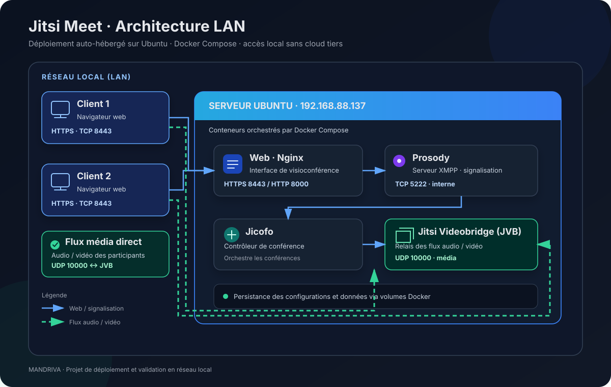

# 🎥 Jitsi Meet — Serveur de Visioconférence en Réseau Local

[](https://ubuntu.com/)
[](https://www.docker.com/)
[](https://jitsi.org/)
[](LICENSE)
[]()

> Déploiement d'un serveur de visioconférence **Jitsi Meet** auto-hébergé, fonctionnant **entièrement en réseau local (LAN)**, sans aucune dépendance à Internet.

---

## 📑 Table des Matières

- [Contexte et Objectifs](#-contexte-et-objectifs)
- [Architecture de la Solution](#-architecture-de-la-solution)
- [Prérequis](#-prérequis)
- [Installation Pas à Pas](#-installation-pas-à-pas)
- [Incidents Rencontrés et Résolutions](#-incidents-rencontrés-et-résolutions)
- [Tests de Validation](#-tests-de-validation)
- [Procédures d'Exploitation](#-procédures-dexploitation)
- [Guide Utilisateur](#-guide-utilisateur)
- [Recommandations Futures](#-recommandations-futures)
- [Conclusion](#-conclusion)
- [Licence](#-licence)

---

## 🎯 Contexte et Objectifs

### Contexte
Dans le cadre de la mise en place d'une solution de communication interne, il a été décidé de déployer un serveur de visioconférence **open source**, **auto-hébergé**, fonctionnant **entièrement en réseau local**, sans aucune dépendance à Internet ni à des services cloud tiers.

### Objectifs
- ✅ Disposer d'un serveur de visioconférence **local** accessible depuis le réseau LAN
- ✅ Garantir la **confidentialité** des échanges (aucune donnée ne sort du réseau)
- ✅ Permettre à **plusieurs machines** de rejoindre une même salle de réunion
- ✅ Assurer la **persistance** de la configuration et la **facilité de maintenance**

### Solution retenue
**Jitsi Meet** déployé via **Docker Compose**, avec certificat auto-signé et désactivation de Let's Encrypt.

---

## 🏗 Architecture de la Solution

### Composants déployés

| Composant | Rôle | Conteneur Docker |
|-----------|------|------------------|
| **Prosody** | Serveur XMPP (signalisation) | `prosody-1` |
| **Jicofo** | Contrôleur de conférence (orchestration) | `jicofo-1` |
| **JVB** (Jitsi Videobridge) | Pont vidéo (flux audio/vidéo) | `jvb-1` |
| **Web** | Interface web (Nginx) | `web-1` |

### Flux réseau

| Type | Port | Protocole | Usage |
|------|------|-----------|-------|
| Web HTTP | 8000 | TCP | Accès initial / redirection |
| Web HTTPS | 8443 | TCP | Accès à l'interface Jitsi |
| Signalisation XMPP | 5222, 5269, 5280, 5347 | TCP | Interne uniquement |
| **Vidéo/Audio** | **10000** | **UDP** | **Critique** — flux RTP entre participants |
| COLIBRI (interne) | 8082 → 8080 | TCP | Communication Jicofo ↔ JVB (localhost uniquement) |

### Schéma logique



---

## 📋 Prérequis

| Élément | Valeur / Détail |
|---------|-----------------|
| Système d'exploitation | Ubuntu 22.04 ou 24.04 |
| RAM minimale | 4 Go (8 Go recommandé) |
| CPU | 2 vCPU minimum |
| Adresse IP locale | `192.168.88.137` (à adapter) |
| Accès | Utilisateur avec `sudo` |
| Réseau | LAN uniquement — Internet non requis |
| Nom de domaine | Non requis (IP locale utilisée) |

---

## 🚀 Installation Pas à Pas

### Étape 1 — Mise à jour du système

```bash
sudo apt update && sudo apt upgrade -y
```

### Étape 2 — Installation de Docker et Docker Compose

```bash
sudo apt install -y ca-certificates curl unzip

sudo install -m 0755 -d /etc/apt/keyrings
sudo curl -fsSL https://download.docker.com/linux/ubuntu/gpg -o /etc/apt/keyrings/docker.asc
sudo chmod a+r /etc/apt/keyrings/docker.asc

echo \
  "deb [arch=$(dpkg --print-architecture) signed-by=/etc/apt/keyrings/docker.asc] https://download.docker.com/linux/ubuntu \
  $(. /etc/os-release && echo "$VERSION_CODENAME") stable" | \
  sudo tee /etc/apt/sources.list.d/docker.list > /dev/null

sudo apt update
sudo apt install -y docker-ce docker-ce-cli containerd.io docker-buildx-plugin docker-compose-plugin

sudo usermod -aG docker $USER
```

> **⚠️ Action requise :** se déconnecter puis se reconnecter (ou exécuter `newgrp docker`).

**Vérification :**
```bash
docker --version
docker compose version
```

### Étape 3 — Téléchargement de Jitsi Meet

```bash
wget $(wget -q -O - https://api.github.com/repos/jitsi/docker-jitsi-meet/releases/latest | grep zip | cut -d\" -f4)
unzip docker-jitsi-meet-stable-*.zip
cd docker-jitsi-meet-stable-*/
```

> **Note :** dans le cas présent, la version récupérée a été `stable-11248`.

### Étape 4 — Création de la configuration

```bash
cp env.example .env
./gen-passwords.sh
```

**Vérification :**
```bash
grep -E 'PASSWORD|SECRET' .env
```

### Étape 5 — Configuration pour le réseau local

```bash
nano .env
```

Paramètres à appliquer :

| Variable | Valeur | Rôle |
|----------|--------|------|
| `PUBLIC_URL` | `https://192.168.88.137:8443` | URL publique d'accès |
| `ENABLE_LETSENCRYPT` | `0` | Désactive Let's Encrypt (pas d'Internet) |
| `HTTP_PORT` | `8000` | Port HTTP |
| `HTTPS_PORT` | `8443` | Port HTTPS |
| `JVB_PORT` | `10000` | Port UDP du pont vidéo |
| `JVB_ADVERTISE_IPS` | `192.168.88.137` | IP annoncée aux participants |
| `JVB_COLIBRI_PORT` | `8082` | Évite le conflit sur le port 8080 |
| `TZ` | `Africa/Lubumbashi` | Fuseau horaire |

### Étape 6 — Création des dossiers de persistance

```bash
mkdir -p ~/.jitsi-meet-cfg/{web,transcripts,prosody/config,prosody/prosody-plugins-custom,jicofo,jvb}
```

### Étape 7 — Attribution des permissions

```bash
sudo chown -R 1000:1000 ~/.jitsi-meet-cfg/
```

> **💡 Justification :** le conteneur `web` s'exécute avec l'UID 1000. Le dossier hôte doit appartenir au même UID, sinon le conteneur ne peut pas écrire dans `/storage` et redémarre en boucle.

### Étape 8 — Configuration du pare-feu

```bash
sudo ufw allow 22/tcp
sudo ufw allow 8000/tcp
sudo ufw allow 8443/tcp
sudo ufw allow 10000/udp
sudo ufw enable
```

### Étape 9 — Lancement de la stack Jitsi

```bash
docker compose up -d
```

**Vérification :**
```bash
docker compose ps
```

Résultat attendu :

| Conteneur | État | Ports |
|-----------|------|-------|
| `web-1` | Up | `8000->8000/tcp`, `8443->8443/tcp` |
| `prosody-1` | Up | ports internes |
| `jicofo-1` | Up | `127.0.0.1:8888->8888/tcp` |
| `jvb-1` | Up | `10000->10000/udp`, `127.0.0.1:8082->8080/tcp` |

---

## 🐛 Incidents Rencontrés et Résolutions

### Incident n°1 — Conflit sur le port 8080

**Symptôme :**
```
Error response from daemon: failed to bind host port 127.0.0.1:8080/tcp: address already in use
```

**Cause :** un autre service sur la machine hôte utilisait déjà le port 8080 (port COLIBRI de JVB).

**Résolution :** ajout dans `.env` :
```bash
JVB_COLIBRI_PORT=8082
```
Puis redémarrage :
```bash
docker compose down && docker compose up -d
```

---

### Incident n°2 — Conteneur `web` en boucle de redémarrage

**Symptôme :**
```
FATAL ERROR: directory '/storage' is not writable by the container user (uid 1000).
It maps to a host volume; make it writable by uid 1000.
```

**Cause :** le dossier `~/.jitsi-meet-cfg/web` appartenait à l'utilisateur `cherubin` avec des permissions empêchant l'UID 1000 (utilisateur interne du conteneur) d'y écrire.

**Résolution :**
```bash
sudo chown -R 1000:1000 ~/.jitsi-meet-cfg/
docker compose down
docker compose up -d
```

**Vérification après correction :**
```bash
docker compose ps                    # web-1 doit être "Up"
curl -k -I https://localhost:8443    # doit renvoyer HTTP/1.1 200 OK
```

---

### Incident n°3 — Échec lors de la jonction de la 2ᵉ machine

**Symptôme observé :** message d'erreur affiché côté navigateur :
> *« Malheureusement, un problème est survenu. On essaie d'arranger ça. Reconnexion dans 1 secondes… »*

**Analyse :**
Ce message apparaît typiquement lorsqu'un **deuxième participant** tente de rejoindre la salle. La conférence échoue car :
- soit **Jicofo ne détecte aucun pont vidéo disponible** (`bridge_count = 0`) ;
- soit **JVB n'arrive pas à se connecter à Prosody** (problème d'authentification SCRAM) ;
- soit le **port UDP 10000** n'est pas joignable entre les participants.

**Diagnostic à effectuer :**
```bash
# Vérifier que Jicofo voit bien JVB
curl -s localhost:8888/stats | python3 -m json.tool | grep -i bridge

# Consulter les logs JVB
docker compose logs jvb --tail=50

# Consulter les logs Jicofo
docker compose logs jicofo --tail=50
```

**Résolution appliquée — redémarrage ordonné des services :**
```bash
docker compose restart prosody
sleep 10
docker compose restart jicofo
sleep 10
docker compose restart jvb
```

**Vérifications complémentaires :**
- ✅ `JVB_ADVERTISE_IPS=192.168.88.137` — valeur confirmée correcte
- ✅ Port `10000/udp` autorisé dans UFW — confirmé
- ✅ Port `10000->10000/udp` exposé par le conteneur `jvb-1` — confirmé
- ✅ Test `ping 192.168.88.137` depuis la 2ᵉ machine — validé

**Statut :** ✅ Résolu après redémarrage ordonné et validation de la configuration réseau.

---

## ✅ Tests de Validation

| N° | Test | Commande / Action | Résultat attendu | Statut |
|----|------|-------------------|------------------|--------|
| 1 | Docker opérationnel | `docker --version` | Version affichée | ✅ |
| 2 | Conteneurs actifs | `docker compose ps` | Tous en `Up` | ✅ |
| 3 | Page locale | `curl -k -I https://localhost:8443` | `HTTP/1.1 200 OK` | ✅ |
| 4 | Accès depuis poste LAN | Navigateur → `https://192.168.88.137:8443` | Interface Jitsi | ✅ |
| 5 | Port UDP exposé | `docker compose ps \| grep jvb` | `10000->10000/udp` | ✅ |
| 6 | Pare-feu | `sudo ufw status` | `10000/udp` autorisé | ✅ |
| 7 | Jonction 2ᵉ machine | Salle `test` rejointe depuis 2 postes | Vidéo + audio OK | ✅ |

---

## 🛠 Procédures d'Exploitation

### Démarrer le service

```bash
cd ~/docker-jitsi-meet-stable-11248
docker compose up -d
```

### Arrêter le service

```bash
docker compose down
```

### Redémarrer proprement

```bash
docker compose restart
```

### Consulter les logs

```bash
docker compose logs <service> --tail=100

# Exemples :
docker compose logs jvb --tail=100
docker compose logs web --tail=100
docker compose logs jicofo --tail=100
```

### Mise à jour de Jitsi

```bash
docker compose pull
docker compose down
docker compose up -d
```

### Sauvegarde de la configuration

```bash
tar -czf jitsi-backup-$(date +%F).tar.gz ~/.jitsi-meet-cfg/ .env
```

---

## 👥 Guide Utilisateur

### Accès à la plateforme

Depuis n'importe quelle machine du réseau local :

```
https://192.168.88.137:8443
```

### Acceptation du certificat

Au premier accès, un avertissement de sécurité s'affiche (certificat auto-signé). Il faut :
1. Cliquer sur **« Avancé »**
2. Cliquer sur **« Continuer vers 192.168.88.137 (dangereux) »**

> 💡 Sur Chrome, si le bouton n'apparaît pas : taper `thisisunsafe` au clavier.

### Créer ou rejoindre une salle

- **Créer une salle :** cliquer sur « Démarrer une réunion », saisir un nom de salle.
- **Rejoindre une salle :** accéder directement à l'URL :
  ```
  https://192.168.88.137:8443/nom-de-la-salle
  ```

### Fonctionnalités disponibles

- 🎥 Vidéo et audio bidirectionnels
- 💬 Chat textuel
- 🖥 Partage d'écran
- 🎨 Arrière-plans virtuels
- ⏺ Enregistrement de réunion (si activé)

---

## 🔮 Recommandations Futures

| Priorité | Recommandation | Bénéfice |
|----------|----------------|----------|
| 🟡 Moyenne | Mettre en place un **DNS local** (`meet.local`) | URL mémorisable au lieu de l'IP |
| 🟡 Moyenne | Générer un **certificat auto-signé propre** avec `mkcert` | Évite l'avertissement navigateur |
| 🟢 Basse | Mettre en place une **authentification** (JWT ou LDAP) | Contrôle d'accès |
| 🟢 Basse | Activer l'**enregistrement** local des réunions | Archivage |
| 🟢 Basse | Configurer un **script de sauvegarde automatique** (cron) | Résilience |
| 🟢 Basse | Documenter le **plan de reprise** (restauration Docker + config) | Continuité de service |

---

## 🏁 Conclusion

Le serveur de visioconférence **Jitsi Meet** a été déployé avec succès sur une infrastructure locale basée sur **Docker Compose**. La solution :

- ✅ fonctionne **entièrement en réseau local**, sans aucune dépendance à Internet ;
- ✅ garantit la **confidentialité** des échanges ;
- ✅ permet à **plusieurs participants** de rejoindre une même salle depuis différentes machines du LAN ;
- ✅ repose sur une **configuration persistante** et facilement sauvegardable.

**Trois incidents** ont été rencontrés et résolus :

1. 🔧 Conflit de port **8080** → résolu par `JVB_COLIBRI_PORT=8082`
2. 🔧 Permissions du dossier de configuration → résolu par `chown -R 1000:1000`
3. 🔧 Échec de jonction d'un second participant → résolu par redémarrage ordonné et validation des paramètres réseau

La plateforme est **opérationnelle** et prête à l'emploi pour des réunions internes en réseau local.

---

**Rapport rédigé le 11 octobre 2026.**

⭐ Si ce guide vous a aidé, n'hésitez pas à mettre une étoile sur le dépôt !
